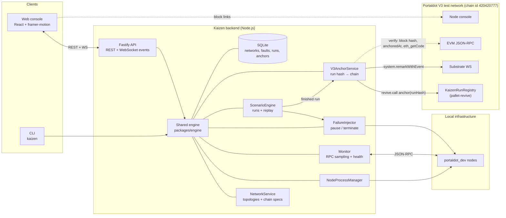

# Kaizen

**Break Portaldot networks on purpose. Prove it on chain.**

Kaizen is a node operations and infrastructure platform for the Portaldot
blockchain. It creates real multi-node `portaldot_dev` networks, monitors
them live, breaks them deliberately in a gated Failure Lab with replayable
scenarios, verifies recovery independently over RPC, and fingerprints every
finished experiment and anchors it on the **Portaldot V3 test network** —
from a web console and a CLI that share one engine.

```
CREATE → MONITOR → BREAK → DIAGNOSE → RECOVER → DEPLOY
                                 └──→ ANCHOR ON PORTALDOT V3
```

Nothing in the UI is mocked: every number comes from real RPC, real process
state, recorded history, or the V3 chain. Features that are not built yet are
shown disabled and labelled with their phase — never simulated.

## Current status (2026-10-21, Hacker House Week 2)

| Area | Status |
|---|---|
| Node lifecycle (binary download + SHA-256, spawn/stop/purge, ports, logs) | **Verified** on the real binary (Phase 1) |
| Topologies: single, two-node, four-validator, validator + full node, custom | **Verified** (Phase 2A) |
| Live monitoring (peers, heads, finality, sync, health state machine, WS events) | **Verified** (Phase 2A/2B) |
| Failure Lab engine: `pause` (SIGSTOP/SIGCONT), `terminate` (stop + restore), dry run, test-network gate, audit log | **Verified** live (Phase 3B) |
| Scenarios: authoring, validation, execution with evidence, cancel (cross-process), replay | **Verified** live (Phase 3C–3F) |
| CLI for scenarios/runs | **Verified** live (T-3.6A) |
| **Portaldot V3 connectivity probe** (Substrate WS, EVM RPC, node console) | **Verified** live (T-8.1) |
| **Portaldot V3 run anchoring** (KaizenRunRegistry contract + remark, verify) | **Verified** live on the V3 test network (T-8.2) |
| Web console (new design): Overview, node drawer, Failure Lab, Scenarios, Incidents evidence, Deployments, Validators, V3, Settings | **Implemented** — 55 jsdom tests; not yet driven in a real browser against a live network (RSK-23) |
| `peer-disconnect` / `partition` faults | Blocked by the engine with typed reasons (R-22) — shown disabled |
| Incident detection & correlation | Phase 4 — not built |
| Validator operations (staking, session keys) | Phase 5 — not built |
| Docker / Kubernetes (Helm) deployment | Phase 6 — not built (planned scope) |

Full detail: [docs/IMPLEMENTATION_PLAN.md](docs/IMPLEMENTATION_PLAN.md) ·
[docs/PROGRESS.md](docs/PROGRESS.md) · [docs/PHASE_REPORT.md](docs/PHASE_REPORT.md).

## Architecture



## Portaldot V3 integration

Kaizen treats a finished Failure Lab run as evidence worth proving:

1. **Fingerprint** — `computeRunHash` = SHA-256 of the canonical JSON of the
   persisted run record (steps, observations, cleanup, outcome).
2. **Anchor** — written to the V3 test network either through the
   **KaizenRunRegistry** Solidity contract (`contracts/KaizenRunRegistry.sol`,
   EVM bytecode on pallet-revive: `anchor(bytes32 runHash, string meta)`
   emitting `RunAnchored`) or, when chosen explicitly, via
   `system.remarkWithEvent("kaizen:v1:<runHash>:<runId>")` (DEC-027).
   Writes happen only on an explicit, confirmed request, are signed by an
   operator key read from `KAIZEN_V3_SIGNER_SURI` only, and are dry-run
   first; records are persisted before submission and a submission without
   on-chain evidence is recorded as `failed`, never as anchored (DEC-026).
3. **Verify** — recompute the hash from the stored run and re-read the chain:
   block hash at the recorded height, registry `anchoredAt(runHash)`,
   `eth_getCode` for the registry, or the remark text.

Surfaces: CLI `kaizen v3 probe | status | hash | anchor | anchors | verify`
(plus operator-only `deploy-registry` / `import-deployment`), API
`/api/v3/probe|status|anchors|runs/:runId/hash`, `POST /api/v3/anchors`,
`POST /api/v3/anchors/:id/verify`, and the console's **Portaldot V3** screen.

Endpoints (overridable via `KAIZEN_V3_*`): `wss://test-node-v3.portaldot.dev`,
`https://test-evm-rpc-v3.portaldot.dev`, `https://node-console.portaldot.dev`.

### Testnet evidence

Chain **PortaldotV3 Test**, EVM chain id **420420777**, genesis
`0xd4f9acbcf7f52388d8b095abe3c198d19fc510e0343e643e87cfbccb155283bd`.
Signer (public): `5HSwNUrjU8VqBfdjJdmGdEYig96V1uR6qySiKTZF6eoBd32o`.

| What | Block | Transaction hash | Details |
|---|---|---|---|
| KaizenRunRegistry deployed | [136822](https://node-console.portaldot.dev/?rpc=wss%3A%2F%2Ftest-node-v3.portaldot.dev#/explorer/query/0x567175bb40b891a5103e00c74b1b15b227a67f3da1aa93ef8264a09f580ecef2) | `0x2fa1c5ae2de79d71ca663d7e7050cc9995e4803b234ade6dd916bc3a8d5eff30` | contract `0x08fdadd1ebe16234c03b723255cc12fd98a5ef07` |
| Contract anchor — run `run-mvim409r-32019a7e` | [136899](https://node-console.portaldot.dev/?rpc=wss%3A%2F%2Ftest-node-v3.portaldot.dev#/explorer/query/0x2efd3f718fd67b044dd23fc7c2135c4cd69c53f6f5dd99170a9fc5e073eb0c69) | `0xa06abaa085c59486bd2a8d8e4d593b30a9a6e521c7908c6de4b3bdbb70f8c5b7` | `pause-alice-drill`, run hash `0x24c2d025…bf1214`, finalized |
| Contract anchor — run `run-mvim7jct-5df7ea0f` | [136919](https://node-console.portaldot.dev/?rpc=wss%3A%2F%2Ftest-node-v3.portaldot.dev#/explorer/query/0x4f8d4617013382d0c07acb54c7a25ae10a737ed4077ed3383e14b7526b2f7a56) | `0x8ae9cfc07d559c9dc058472869ae6daa1c364d8965f597704bcc44893abd4df9` | `terminate-bob-drill`, finalized |
| Remark anchor — run `run-mvim409r-32019a7e` | [136940](https://node-console.portaldot.dev/?rpc=wss%3A%2F%2Ftest-node-v3.portaldot.dev#/explorer/query/0x9a2b7b6d5522e54e0ec44d486f5e8b5d8e1c075797bde732209b2fa4267fa6f3) | `0xa9b15505f07d72738159fb24af61f9959319f7e241125c4b1e82d1c8ab1173ff` | `pause-alice-drill` (same run as 136899), finalized |
| Remark anchor — run `run-mvim9v7m-875cdcaa` | [136947](https://node-console.portaldot.dev/?rpc=wss%3A%2F%2Ftest-node-v3.portaldot.dev#/explorer/query/0x739af302a1aab00977f1af04c619a8cc5ea97d91e8c36a00c1f0e5699fe9e38a) | `0x84027d2397efce0930e1a5abd49b77a741a8820f4373ebb8dc9c97f7fd774f49` | `pause-alice-drill` (replay), run hash `0x26ebf52f…edd9c`, finalized |

All four anchors were re-verified on chain on 2026-10-21 (`verified`: hash and
block hash match; contract anchors also show registry code present and
`anchoredAt`). The anchored runs were real `pause` / `terminate` Failure Lab
runs on a local two-node `portaldot_dev` network; the exact run records are
in [docs/evidence/runs/](docs/evidence/runs/), the anchor records (including
two honestly recorded failed attempts) in
[docs/evidence/v3-anchors.json](docs/evidence/v3-anchors.json), and a unit
test recomputes every anchored hash from them.


Costs observed on the V3 test network: ≈85 tPOT to deploy the registry,
≈4 tPOT storage deposit per contract anchor, ≈0.02 tPOT per remark (RSK-30).

## Quickstart

Prerequisites: Node.js 24+, npm 11+, Linux x86_64 or macOS (upstream ships no
linux-arm64 node binary — RSK-31), ~1 GiB RAM per running node.

```bash
git clone https://github.com/Shaydez-Defi/kaizen
cd kaizen
npm install
npm run build                       # engine → cli → api → web
node packages/cli/dist/index.js setup   # download + verify portaldot_dev (SHA-256 recorded)
```

Run the console:

```bash
node apps/api/dist/index.js         # API + WS on http://127.0.0.1:4310
npm run dev -w @kaizen/web          # console on http://127.0.0.1:5173 (proxies /api)
```

Open the console → **Create network** (e.g. 2 node) → watch **Overview** →
**Failure Lab**: pause a node, watch the live fault log and verified recovery
→ **Scenarios**: run or replay a drill → **Portaldot V3**: anchor the finished
run and verify it.

Or from the CLI (same engine):

```bash
K=node packages/cli/dist/index.js
$K network create demo --preset two-node
$K network start demo
$K network monitor demo
$K scenario create my-drill.json        # see docs/evidence/runs/*.json → snapshot for a valid shape
$K run execute <scenarioId> -n demo
$K v3 probe                             # read-only
$K v3 status                            # signer address + balance, registry in effect
KAIZEN_V3_SIGNER_SURI='…' $K v3 anchor <runId> --method remark
$K v3 verify <anchorId>
$K network stop demo
```

Writes to V3 need a funded test account in `KAIZEN_V3_SIGNER_SURI`
(never committed, never passed over HTTP). Runtime state lives in
`./.kaizen/` (gitignored) or `$KAIZEN_DATA_DIR`.

What was verified, where: build/typecheck/lint/unit suite (379 tests) on
2026-10-21; API start + V3 probe/status/verify live on 2026-10-21; node
lifecycle and Failure Lab flows live in earlier phases (commands and results
in [docs/TESTING.md](docs/TESTING.md)).

## Development

```bash
npm test                            # unit + jsdom tests (no network, no binary)
npm run typecheck && npm run lint
KAIZEN_TEST_LIVE=1 npm run test:integration   # real nodes (x86_64 host)
KAIZEN_TEST_V3=1 …                            # live V3 probe
KAIZEN_TEST_V3_WRITE=1 KAIZEN_V3_SIGNER_SURI=… …  # live V3 anchoring (spends tPOT)
```

Gated suites are **skipped** without their flag and never reported as passed.

## Documentation

| Document | Purpose |
|---|---|
| [docs/PROJECT_SPEC.md](docs/PROJECT_SPEC.md) | Locked scope, goals, acceptance criteria |
| [docs/ARCHITECTURE.md](docs/ARCHITECTURE.md) | Components, V3 anchoring path, security boundaries |
| [docs/IMPLEMENTATION_PLAN.md](docs/IMPLEMENTATION_PLAN.md) | Phases, task IDs, statuses |
| [docs/PROGRESS.md](docs/PROGRESS.md) | Chronological engineering log |
| [docs/DECISIONS.md](docs/DECISIONS.md) | Decision records (DEC-026/027 V3 anchoring, DEC-028 console) |
| [docs/TESTING.md](docs/TESTING.md) | Test strategy, commands, actual results |
| [docs/RISKS.md](docs/RISKS.md) | Risk register |
| [docs/TECHNICAL_RESEARCH.md](docs/TECHNICAL_RESEARCH.md) | Portaldot capability matrix |
| [docs/PHASE_REPORT.md](docs/PHASE_REPORT.md) · [docs/reports/](docs/reports/) | Phase reports |
| [docs/DEMO.md](docs/DEMO.md) · [docs/SUBMISSION.md](docs/SUBMISSION.md) | Demo shot list, DoraHacks Week 2 fields |
| [AGENTS.md](AGENTS.md) | Build governance for agents |

## License

MIT — see [LICENSE](LICENSE).
