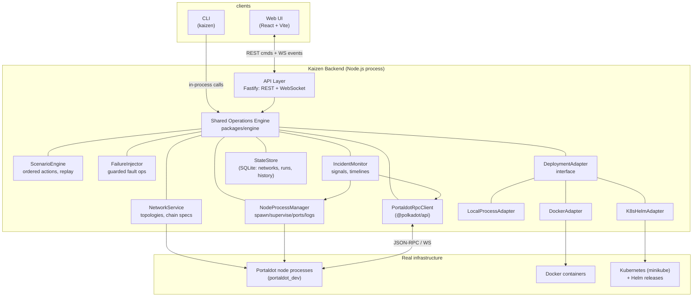
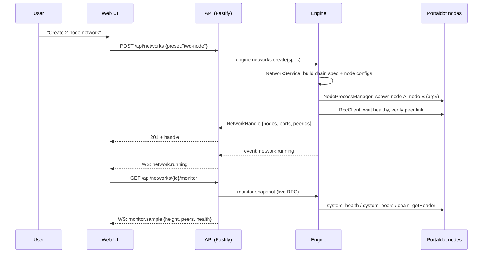
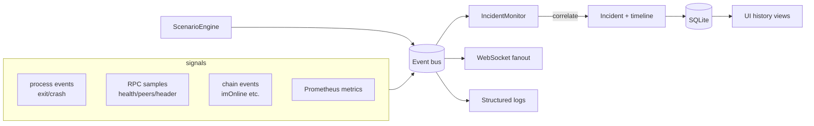

# Kaizen — Architecture

Status: PROPOSED (Phase 0) — to be revisited at each phase gate in `docs/PROGRESS.md`.

## 1. Design Principles

1. **The backend owns operations.** The web UI never spawns processes, never
   executes shell commands, and never talks to node RPC directly.
2. **One engine, two frontends.** CLI and Web UI call the same application
   services (`packages/engine`). No duplicated network/node/scenario logic.
3. **Adapters at the edges.** Everything external (Portaldot binary, RPC, Docker,
   Kubernetes) sits behind a typed adapter interface, so core logic stays
   testable without live infrastructure.
4. **No fabricated data.** Every number rendered by UI/CLI originates from real
   RPC, real process state, or real recorded history. Unimplemented operations
   are hidden, not faked.
5. **Boring, testable stack.** One language (TypeScript) across engine, API,
   CLI, UI. Modular monolith — no microservices.

## 2. Component Overview



## 3. Component Responsibilities

| Component | Responsibility |
|---|---|
| **Web UI** (`apps/web`) | Operations console (React 19 + Vite): Overview, Networks (+ create), Network detail, Node detail, Events. Thin typed client over the API/WS only (DEC-016): one shared API client for base-URL/errors/timeouts, one WebSocket in a React context (auto-reconnect + resync refetch), engine models via `import type`. Renders only engine-provided data; the browser never launches processes or runs shell commands. |
| **CLI (`kaizen`)** | Scriptable surface (human + `--json` output). Thin argument parsing → engine calls. Exit codes for automation. |
| **API Layer** | HTTP for commands/queries; WebSocket for engine event stream. Input validation (Zod), auth-less by design for localhost-first (see §8). |
| **Operations Engine** | The single source of operational truth. Application services with typed inputs/outputs; emits events; persists history. |
| **NetworkService** | Topology presets (data-driven: single/two/four-validator/validator-fullnode + validated custom) → concrete network definitions: chain spec generation, per-node config (base-path, ports, keys, roles, bootnodes), ordered start/stop, per-node start/stop, purge, partial-create rollback. |
| **ChainSpecService** | Per-network spec artifacts: plain spec → typed authority patch (keys derived from the real binary, DEC-011) → `build-spec --raw` rebuild; audit sidecar (`chain-spec.genesis.json`); no-op for topologies whose authorities are already in the stock spec. |
| **MonitoringService** | Polls running networks (one job per network, 2s cadence, in-flight guard): HTTP JSON-RPC sampler → pure health state machine (`unknown/healthy/unhealthy/unavailable/stale`) → typed `monitor.*` events; auto-starts/stops from `network.status` bus events; `snapshotNow()` for on-demand reads (DEC-012/DEC-015). |
| **NodeProcessManager** | Spawns/kills node processes via **argv arrays** (never shell strings), per-node workdirs, log capture, port allocation, health polling, restart policies. |
| **PortaldotRpcClient** | Typed wrapper over `@polkadot/api`: health, peers, sync, headers, events, storage reads. Reconnect/backoff logic. |
| **ScenarioEngine** | Loads scenario definitions (ordered actions + delays), executes with recording (action, ts, result, error), supports replay of the action sequence. |
| **FailureInjector** | Executes guarded fault operations (stop, SIGSTOP pause, peer disconnect via reserved-peer RPC or rewire, partition by isolation) — only against designated test networks. |
| **IncidentMonitor** | Subscribes to signals (process exit, RPC unreachable, peer count drop, block stall, `imOnline` events), correlates into incidents with timelines + evidence. |
| **DeploymentAdapter** | Uniform interface: `deploy / status / logs / destroy / recover`. Implementations: Local (Phase 1), Docker (Phase 6), K8s/Helm (Phase 6). |
| **StateStore** | SQLite persistence: networks, node configs, scenario definitions, run history, incidents, evidence references. |

## 4. Interfaces & Communication

- **Web ↔ API**: REST for commands (`POST /api/networks`,
  `POST /api/networks/{id}/purge`, `POST /api/nodes/{id}/start|stop`,
  `POST /api/networks/{id}/start|stop|remove`, …) and queries
  (`GET /api/networks/{id}/nodes/{nodeId}`, `GET /api/networks/{id}/monitor`,
  `GET /api/networks/{id}/nodes/{nodeId}/logs` — real log-tail bytes from the
  engine, DEC-016/DEC-017);
  WebSocket `/api/events` for the engine event bus (network lifecycle,
  node lifecycle, typed `monitor.sample` / `monitor.health` / `monitor.peers`
  / `monitor.error`, operation results — every payload carries timestamps and
  ids). Validation via Zod; failures are structured errors with stable codes
  (`INVALID_INPUT` 400, `NETWORK_NOT_FOUND`/`NODE_NOT_FOUND` 404,
  `NETWORK_ALREADY_EXISTS` 409, `NODE_NOT_RUNNING` 409, …).
- **CLI ↔ Engine**: direct in-process imports of `packages/engine` (same
  service objects the API uses). Rationale in DEC-002. Both surfaces call the
  shared engine only — no operation logic is duplicated at either edge.
- **Engine ↔ Nodes**: child processes (local adapter), container control
  (Docker adapter), K8s API + Helm CLI (K8s adapter); node data via RPC.



## 5. Portaldot Integration Boundaries

- **Binary management**: Kaizen downloads/caches `portaldot_dev` + `subkey`
  into `.kaizen/bin/`, records SHA-256 at first fetch (DEC-007). No source
  builds.
- **Node control plane**: purely via CLI flags + signals + subcommands
  (`build-spec`, `purge-chain`, `key insert`) — no unsupported internals.
- **Data plane**: JSON-RPC/WebSocket via `@polkadot/api` only. V13 metadata is
  handled by the SDK.
- **Chain interaction policy**: Kaizen never signs mainnet transactions; all
  write operations (staking/session) are Phase 5, guarded, and local-testnet
  first.

## 6. Process & Network Lifecycle

```
NetworkDefinition (preset or validated custom topology)
   → topology validation FIRST (duplicate names/keys, port/path safety,
     stale chain data) — before any dir, port, or process is touched
   → ChainSpec per network (plain spec → authority patch with binary-derived
     keys when authorities ⊄ {alice, bob} → build-spec --raw;
     audit sidecar records baked-in authorities)
   → NodeConfig[] (base-path, p2p/rpc/ws/prom ports, role, keys, bootnodes,
     expected_peers = nodeCount − 1)
   → partial-create rollback on any failure (dirs + ports returned, no debris)
   → spawn order: seed/authority node first, then the rest (bootnodes wired)
   → health-gate: each node must reach "synced + peers expected" (with timeout)
   → RUNNING + monitoring auto-attach (bus event) → per-node or full STOP
     (reverse order, SIGTERM→SIGKILL) → STOPPED
   → optional PURGE: refuses while any node is alive, then wipes chain DBs
     (keeps identity/ports/spec) → next start boots from genesis again
```

Failure states are first-class: `DEGRADED` (some nodes down), `UNREACHABLE`
(all RPC lost), `STALLED` (no new blocks > threshold) — implemented as the
per-node health machine (`unknown/healthy/unhealthy/unavailable/stale`,
DEC-012). Cleanup always releases ports and records final state.

**Fault injection (`engine.faults` — FailureInjector, T-3.2):** faults
operate on this same lifecycle, never around it, and only ever against
`designatedTest` networks (DEC-008). The injector is a typed service with:

- **Narrow adapters** — one per Phase 3A-verified mechanism (R-22), each
  declaring its type, required privileges, preflight checks, bounded
  execution, expected observable effect, verification method, timeout
  behaviour, cleanup, and failure semantics. Implemented today: `pause`
  (SIGSTOP/SIGCONT on a re-verified managed PID — R-22 A) and `terminate`
  (engine stopNode/startNode with a NEW pid — R-22 D). `peer-disconnect`
  and `partition` are registered as explicit BLOCKED adapters: they fail
  with typed unsupported results naming the precise unblock path (e.g.
  reserved-only topology wiring, DEC-018 operator authorization) and NEVER
  substitute a mechanism proven ineffective (plain reserved-peer RPC,
  proxy-only cuts, static port firewall rules — R-22 negatives).
- **Safety boundary** — every request is revalidated with fresh reads at
  execution time: designatedTest + local chain, node ∈ network, engine-
  managed running process, stable identity (pid + `kaizen-node.pid`
  agreement — a reused PID or ambiguous process is refused, never
  signalled), one active fault per node, quarantine check. Dry-run is the
  default surface; `execute()` is a separate explicit action (over REST it
  additionally demands a literal `mode:"execute"` body marker). Privileged
  (sudo-level) faults are deliberately NOT implemented — the engine never
  escalates privileges or touches host firewall state (DEC-018).
- **Lifecycle & audit** — `requested → validating → (rejected | ready →
  executing → verifying → cleaning-up → completed | failed | cancelled |
  cleanup-failed)`; illegal transitions are refused, every transition is
  persisted to the SQLite `faults` table and emitted as a `fault.state`
  event. Accepted, rejected, executed, verified, and cleaned-up requests
  are all recorded with actor, target, plan, and structured evidence.
- **Verification discipline** — command-accepted, mechanism-applied,
  effect-observed, fault-removed, recovered, and recovery-verified are
  separate claims in the result (never one collapsed "success" flag),
  backed by bounded polling against the node's own RPC and the process
  table (e.g. pause = RPC unreachable WHILE pid alive; restart = NEW pid
  answering RPC). Cleanup runs on completion, error, timeout, and
  cancellation paths; if rollback cannot be proven the fault is marked
  `cleanup-failed`, a high-severity `fault.cleanup-failed` event is
  emitted, and the target is quarantined until `reconcile()` proves the
  effect is gone. `engine.close()` cancels in-flight faults and resumes
  paused processes — no stopped process outlives the engine.

Kernel-level isolation (port/cgroup firewall rules or a per-node netns +
veth) remains an operator-authorized fallback under DEC-018: narrow scope
to one process/link on both IP families, no interface scoping, no
FORWARD/DOCKER chains, no host-global firewall changes, with the pre/post
baseline captured and byte-identical rollback verified on every exit path.
A partition claim is only valid with evidence from the unaffected nodes
too (peer sets, `ss`, head/finality progression) — never from the
target's silence alone.

## 7. Data & Event Flow (monitoring)



## 8. Security Boundaries

- **Command execution**: engine spawns with argv arrays only; no string shells;
  no user-controlled flags passthrough without allowlist validation.
- **Input validation**: all API/CLI inputs validated with Zod schemas at the
  boundary; unknown fields rejected.
- **Network exposure**: node RPC stays on loopback; Kaizen binds API to
  localhost by default. Nodes run with `--rpc-methods Auto` (unsafe methods
  only on loopback) — never `--unsafe-rpc-external` in generated configs.
- **Secrets**: node keys/keystore material live in per-network dirs outside
  git (`.kaizen/` in `.gitignore`); never logged, never returned via API.
- **Blast-radius gate**: failure injection and any destructive op require the
  target network to carry `designatedTest: true`; chain must be Local/
  Development type (FR-5, DEC-008). The FailureInjector enforces this with
  fresh reads at execution time, refuses targets whose managed-process
  identity is ambiguous, and exposes no generic command/signal/executable
  surface — only typed fault methods on registered disposable networks
  (T-3.2; privileged faults are not implemented, DEC-018).
- **Supply chain**: upstream binaries carry no signatures; we record hashes
  TOFU and surface them in the UI (RSK-07).

## 9. Deployment Adapters

| Adapter | Mechanism | Phase |
|---|---|---|
| LocalProcess | child_process argv spawn (same as dev engine) | 1 |
| Docker | image with `portaldot_dev`; compose-style multi-node; volume per node | 6 |
| K8s/Helm | Helm chart: StatefulSet per node role, PVCs, Services, headless service for peering, readiness probes from RPC health | 6 (wow-factor) |

All adapters implement:
```ts
interface DeploymentAdapter {
  deploy(def: NetworkDefinition): Promise<DeploymentHandle>;
  status(handle): Promise<DeploymentStatus>;   // real health, not assumptions
  logs(handle, opts): AsyncIterable<LogLine>;
  destroy(handle): Promise<void>;
  recover(handle, action): Promise<RecoveryResult>;
}
```

## 10. Stack Recommendation (DEC-001 justification)

| Layer | Choice | Why |
|---|---|---|
| Language | TypeScript on Node.js 24 | One language for engine/API/CLI/UI; installed and verified here; strong typing for typed interfaces (FR-3); best-in-class Substrate client `@polkadot/api` (V13-compatible). |
| API | Fastify + Zod | Fast, schema-first validation, first-class WebSocket plugin. |
| Realtime | WebSocket (ws via `@fastify/websocket`) | Engine event fanout; no extra infra. |
| RPC client | `@polkadot/api` | Canonical Substrate RPC/metadata handling; avoids hand-rolled SCALE. |
| Frontend | React + Vite | Fast dev loop, rich ecosystem; fits the "real dashboard" wow-factor. |
| Storage | SQLite (`better-sqlite3`) | Zero-infra persistence for networks/runs/history; single file, easy backup. |
| CLI | commander + shared engine | Thin layer; `--json` mode for automation. |
| Containers/K8s | docker CLI via argv; Helm CLI via argv; minikube | All present in env (Docker 29.8, kubectl 1.37, Helm 4.3, minikube). |
| Tests | vitest (unit/integration) + Playwright (e2e, later) | Same toolchain, fast, TS-native. |

**Alternatives considered** (see DEC-001 for the decision record):
- *Python backend*: official SDK exists, but `substrate-interface` has a
  documented signing bug on Portaldot V13 (R-16) and would split the stack.
- *Go backend*: no mature Substrate client; would require hand-rolled SCALE
  codec — unjustified risk.
- *Microservices*: rejected; a modular monolith runs everywhere and keeps
  operations atomic (project constraint).

## 11. Repository Layout (target)

```
kaizen/
  AGENTS.md                 governance for agents
  README.md
  docs/                     this documentation set
  package.json              npm workspaces root
  packages/
    engine/                 the shared operations engine
    cli/                    kaizen CLI
  apps/
    api/                    Fastify REST + WS server
    web/                    React UI
  charts/
    portaldot/              Helm chart (Phase 6)
  test/                     cross-package integration/e2e tests
  .kaizen/                  runtime state (gitignored): bins, networks, db
```

## 12. Open Architecture Questions

1. WS RPC client compatibility with this node build (T-1.5 resolves).
2. Genesis authority set of Local Testnet → topology preset design (T-2.1).
3. Partition simulation mechanism on a single host (T-3.1 evaluates
   reserved-peer RPC vs process isolation vs port rewiring).
4. Helm v4 vs v3 chart compatibility on the installed client (T-6.3).
5. minikube resource envelope for 4-node networks on 2 vCPU (T-6.4).
